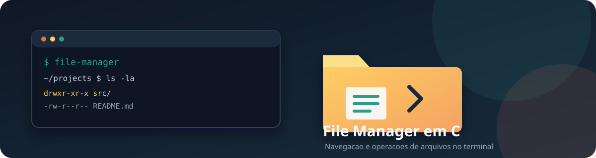

# File Manager

Gerenciador de arquivos interativo para Linux, escrito em C11 e baseado em APIs POSIX.



## Estado desta entrega

Esta branch amplia a versão inicial com operações de cópia, movimentação, remoção controlada e consulta de metadados. A interface aceita caminhos com espaços entre aspas. A implementação permanece deliberadamente pequena: sem dependências externas e sem remoção recursiva. A aplicação usa um FileSystemPort injetável e operações de folha relativas a descritores de diretório.

## Requisitos

- Linux ou sistema POSIX compatível.
- GCC ou Clang com suporte a C11.
- GNU Make.

## Compilar e testar

```sh
make
make test
make test-asan
./file-manager
```

Para limpar os binários:

```sh
make clean
```

## Comandos

| Comando | Comportamento |
|---|---|
| `ls [caminho]` | Lista entradas, tipo, tamanho, permissões e data de modificação |
| `cd <diretório>` | Altera o diretório da sessão |
| `pwd` | Exibe o diretório atual |
| `touch <arquivo>` | Cria arquivo vazio; falha se já existir |
| `mkdir <diretório>` | Cria diretório |
| `cp <origem> <destino>` | Copia arquivo regular para destino inexistente |
| `mv <origem> <destino>` | Move ou renomeia sem sobrescrita intencional |
| `rm <arquivo|link>` | Remove arquivo ou link simbólico após confirmação |
| `rmdir <diretório>` | Remove somente diretório vazio após confirmação |
| `stat <caminho>` | Exibe tipo, tamanho, permissões e modificação |
| `help`, `exit` | Ajuda e encerramento |

Use aspas para caminhos com espaços:

```text
mkdir "meus documentos"
touch "meus documentos/notas de campo.txt"
cp "meus documentos/notas de campo.txt" "copia de notas.txt"
```

## Política de segurança e semântica

- O programa opera com as permissões do usuário que o executa; não é sandbox.
- Listagem e `stat` usam `lstat`: links simbólicos são identificados sem seguir o link final.
- `cp` aceita somente arquivos regulares, abre origem com `O_NOFOLLOW` e cria destino exclusivamente; não sobrescreve.
- Se uma cópia falhar, o destino parcial é removido quando possível.
- `rm` remove arquivos e links, nunca diretórios.
- `rmdir` só remove diretórios vazios. Não existe `rm -r`.
- `mv` verifica se o destino existe antes de renomear. Em sistemas sem primitiva atômica de renomeação sem substituição, uma corrida concorrente ainda pode ocorrer entre a verificação e o rename; não use como ferramenta de transação contra processos hostis concorrentes.
- Caminhos relativos são resolvidos a partir do diretório lógico da sessão. As permissões e regras do filesystem continuam sendo aplicadas pelo kernel.

Consulte [doc/seguranca.md](doc/seguranca.md) antes de usar em diretórios com dados críticos.

## Arquitetura

- `include/file_manager.h`: contrato público do serviço.
- `src/file_manager.c`: operações de filesystem e tradução de erros.
- `ui/terminal_ui.c`: leitura, despacho e renderização do terminal.
- `src/command_parser.c`: lexer isolado, testado independentemente.
- `src/file_manager_application.c`: validação e despacho de casos de uso sem I/O de terminal.
- `include/filesystem_port.h`: contrato injetável de filesystem.
- `adapters/posix/filesystem_posix.c`: adapter POSIX usado pela aplicação.
- `src/main.c`: composition root e inicialização.
- `test/test_file_manager.c`: testes POSIX com diretório temporário.

A aplicação recebe o FileSystemPort por injeção; os testes substituem operações por um fake. O backend POSIX está isolado em adapters/posix/.

## Limitações conhecidas

- `cp` não copia diretórios, preserva ACLs, xattrs, ownership nem timestamps.
- `mv` entre filesystems pode falhar com `EXDEV`; não faz fallback de cópia e remoção.
- Não há remoção recursiva, busca, filtros, modo TUI ou operação em lote.
- As operações finais usam dirfd (openat, fstatat, unlinkat, renameat2), mas a resolução do diretório pai ainda percorre componentes por pathname. Não é sandbox nem proteção completa contra adversário local que controla diretórios ancestrais.

## Licença

MIT. Consulte [LICENSE](LICENSE).
