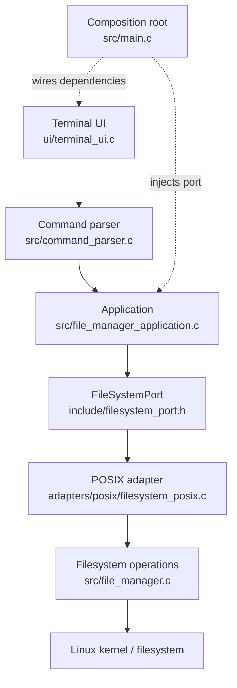

# Arquitetura de software

## 1. Visão arquitetural

A implementação segue uma separação em camadas inspirada em arquitetura hexagonal: a aplicação recebe um contrato de filesystem, enquanto a composição concreta conecta esse contrato às operações POSIX. A separação é parcial: as operações e syscalls continuam concentradas em `src/file_manager.c`.

**Nota de precisão:** `adapters/posix/filesystem_posix.c` atualmente constrói uma tabela estática de ponteiros para funções. Ele não contém a implementação das syscalls. A implementação concreta permanece em `src/file_manager.c`. A extração dessas operações para um módulo POSIX dedicado é uma possível evolução, não uma característica concluída.

## 2. Componentes e responsabilidades

| Componente | Arquivo(s) | Responsabilidade atual |
|---|---|---|
| Composition root | `src/main.c` | Inicializar sessão, obter adapter, conectar UI e aplicação. |
| Terminal UI | `ui/terminal_ui.c`, `include/terminal_ui.h` | Ler comandos, solicitar confirmações e apresentar resultados. |
| Parser | `src/command_parser.c`, `include/command_parser.h` | Tokenizar linha de comando, aspas e escapes. |
| Application | `src/file_manager_application.c`, `include/file_manager_application.h` | Validar argumentos, despachar casos de uso e exigir confirmação para operações destrutivas. |
| Port | `include/filesystem_port.h` | Declarar a interface de operações que a aplicação consome. |
| Adapter | `adapters/posix/filesystem_posix.c` | Fornecer a implementação concreta da tabela `FileSystemPort`. |
| Core de filesystem | `src/file_manager.c`, `include/file_manager.h` | Implementar operações, resolução de caminhos, chamadas POSIX/Linux e gerenciamento de descritores. |
| Testes | `test/` | Verificar filesystem, parser e aplicação. |

## 3. Fluxo de execução

1. `main.c` inicializa `FileManagerSession` e obtém o `FileSystemPort` POSIX.
2. A UI recebe uma linha do terminal.
3. O parser converte a linha em `argc/argv`; não executa operações de filesystem.
4. A aplicação valida comando e aridade.
5. Para operações destrutivas `rm` e `rmdir`, a aplicação emite um resultado de confirmação antes de chamar o port.
6. A aplicação chama a função correspondente no port.
7. O adapter encaminha a chamada para a função `fm_*` do core.
8. O core executa as chamadas POSIX/Linux, gerencia descritores e retorna `FileManagerResult`.
9. A UI apresenta o resultado e libera os recursos que lhe pertencem.

## 4. Contratos e estruturas de dados

### 4.1 `FileSystemPort`

O port é uma estrutura de ponteiros para funções. Ela inclui operações de navegação, listagem, criação, cópia, movimentação, remoção e consulta de metadados.

A aplicação valida que todos os ponteiros obrigatórios estão presentes antes de despachar um comando. Isso reduz falhas por adapters incompletos em tempo de execução.

### 4.2 `FileManagerResult`

O resultado contém:
- indicador de sucesso;
- código de erro compatível com `errno`;
- caminho associado à operação;
- mensagem descritiva.

O código de erro deve ser preservado para permitir tratamento programático. A mensagem é destinada à apresentação e diagnóstico.

### 4.3 `FileManagerList`

A lista contém um vetor de `FileManagerEntry` e sua quantidade. Quando a operação aloca `entries`, o consumidor deve chamar `fm_list_free()`, inclusive após processar uma listagem bem-sucedida.

### 4.4 `FileManagerSession`

A sessão mantém o caminho do diretório atual como string. O diretório lógico é atualizado por `fm_change_directory()`; não representa um descritor persistente de diretório nem uma raiz de confinamento.

## 5. Gerenciamento de recursos

- Cada operação que abre um descritor é responsável por fechá-lo em todos os caminhos de saída.
- `fm_list_free()` libera o vetor de entradas e reinicializa os campos da lista.
- O adapter não mantém estado nem retém argumentos após o retorno.
- A aplicação não assume ownership de descritores internos do core.
- Em cópia, um destino parcial é removido quando ocorre erro durante a transferência, conforme o fluxo de tratamento implementado.

A revisão de novas operações deve considerar caminhos de sucesso, falha parcial, falha de `close()` e preservação do `errno` original.

## 6. Estratégia de testes

O Makefile organiza três executáveis de teste:

| Suíte | Arquivos | Foco |
|---|---|---|
| Filesystem | `test/test_file_manager.c` | Operações sobre diretórios temporários e semântica do filesystem. |
| Parser | `test/test_command_parser.c` | Tokenização, aspas, escapes e entradas inválidas. |
| Application | `test/test_application.c` | Validação, despacho, confirmação e integração com o port. |

`make test` executa as três suítes. `make test-asan` recompila e executa as suítes com AddressSanitizer e UndefinedBehaviorSanitizer.

## 7. Limites e dívida arquitetural

A arquitetura atual ainda tem pontos de evolução:

1. `src/file_manager.c` concentra resolução de caminhos e múltiplas operações; pode ser dividido em módulos menores.
2. O adapter POSIX é uma tabela de encaminhamento, não uma implementação isolada.
3. A sessão guarda o caminho atual em texto, não um descritor persistente.
4. Não existe uma raiz de filesystem confinada.
5. O teste de integração com filesystem real não substitui testes concorrentes com adversários que alteram componentes de caminho.

Esses itens devem ser tratados como trabalho futuro e não como capacidades existentes.

## 8. Evolução recomendada

A evolução pode ser feita incrementalmente, mantendo contratos e testes:
- extrair o backend POSIX para módulos internos especializados;
- formalizar tipos de erro e contratos de ownership;
- avaliar uma sessão baseada em dirfd persistente;
- adicionar testes de falhas de I/O e concorrência;
- documentar explicitamente qualquer mudança na política de symlinks e resolução de caminhos.
