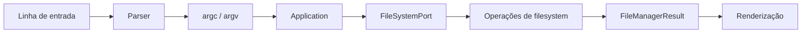
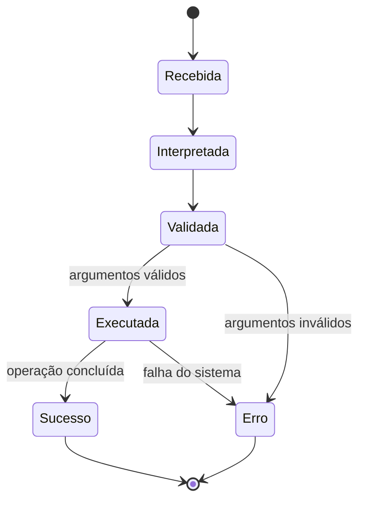

# Modelagem do domínio

Este documento descreve o modelo atual. A modelagem é deliberadamente pequena: a aplicação mantém uma sessão de navegação, recebe comandos e representa resultados de operações sobre entradas do filesystem.

## Entidades e estruturas implementadas

| Conceito | Estrutura C | Campos relevantes |
|---|---|---|
| Sessão | `FileManagerSession` | `current_directory` |
| Entrada | `FileManagerEntry` | `name`, `type`, `size`, `mode`, `modified_at` |
| Lista de entradas | `FileManagerList` | `entries`, `count` |
| Resultado de filesystem | `FileManagerResult` | `success`, `error_code`, `path`, `message` |
| Comando | vetor `argv` | nome do comando e argumentos produzidos pelo parser |
| Resultado de aplicação | `FileManagerAppResult` | tipo do resultado, mensagem, dados de operação e eventual confirmação |

As estruturas de filesystem estão declaradas em `include/file_manager.h`. Os tipos de aplicação e parser estão nos respectivos headers em `include/`.

## Fluxo conceitual

## Ciclo de vida de uma operação

## Ownership

O vetor `FileManagerList.entries` é alocado pelo serviço e deve ser liberado com `fm_list_free()`. Descritores abertos pelas operações pertencem ao fluxo que os abriu e devem ser fechados em caminhos de sucesso e falha. Consulte [arquitetura](arquitetura.md) para os contratos completos.
