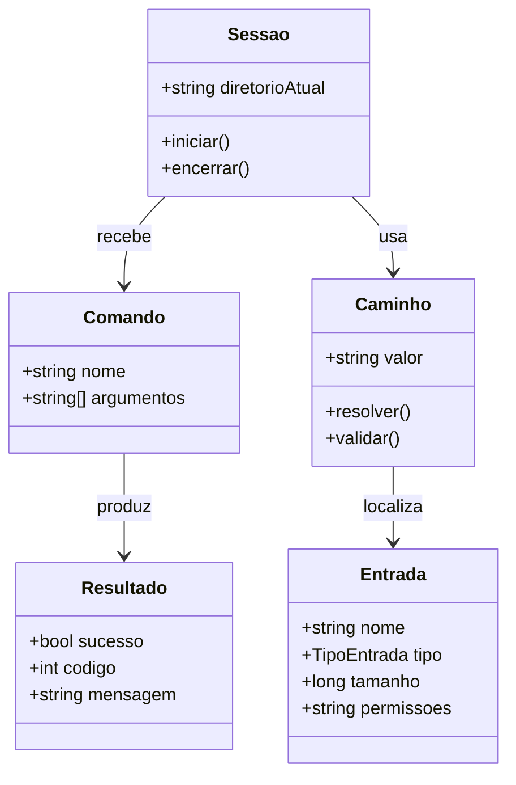
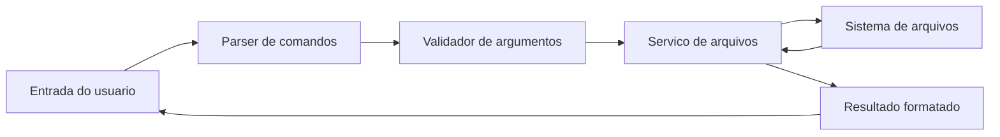
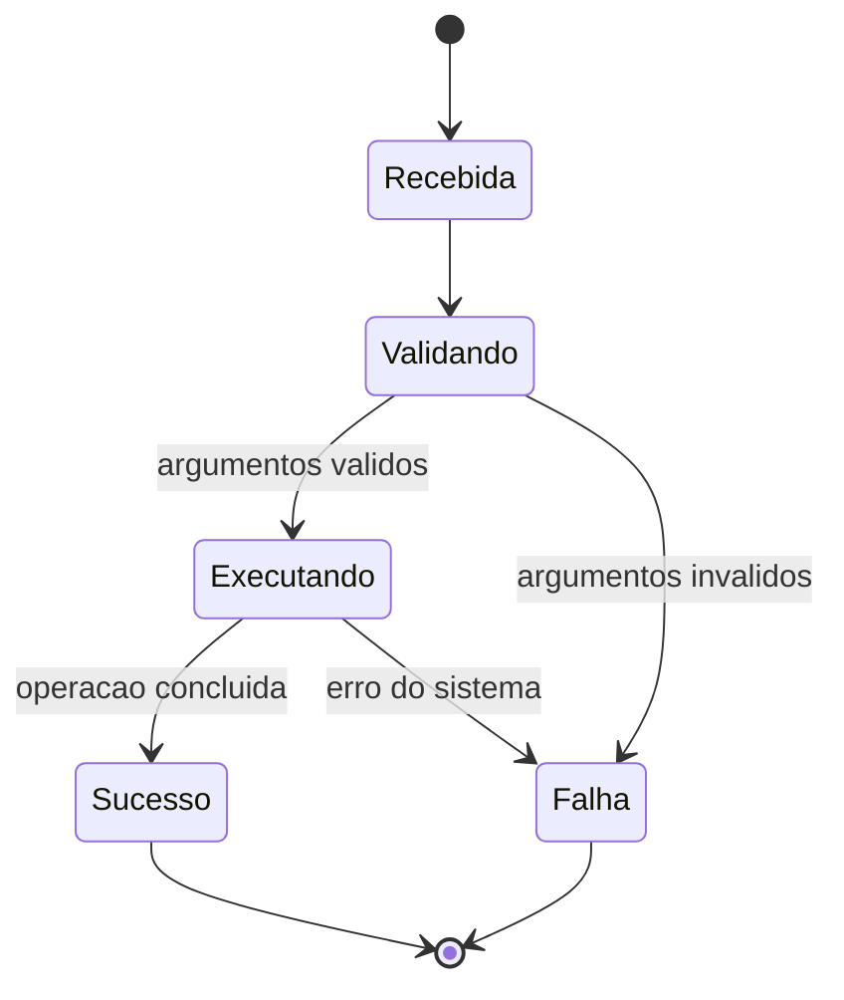

# Modelagem

## Modelo de dominio

O sistema representa uma sessao de navegacao que opera sobre entradas do
sistema de arquivos. Uma entrada pode ser um arquivo, diretorio ou outro tipo
reconhecido pelo sistema operacional.

## Fluxo de dados

## Estados de uma operacao

## Estruturas de dados previstas

- `Comando`: nome da acao e lista de argumentos.
- `Caminho`: texto original e, quando necessario, forma normalizada.
- `Entrada`: metadados retornados por `readdir` e `stat`.
- `Resultado`: status, codigo e mensagem para a camada de interface.
- `Sessao`: contexto do diretorio atual e configuracoes da execucao.

Os tipos concretos estao definidos em `include/file_manager.h`. Nesta primeira
versao, `Entrada` contem nome e tipo; tamanho e permissoes serao incluidos ao
implementar a consulta de metadados.
