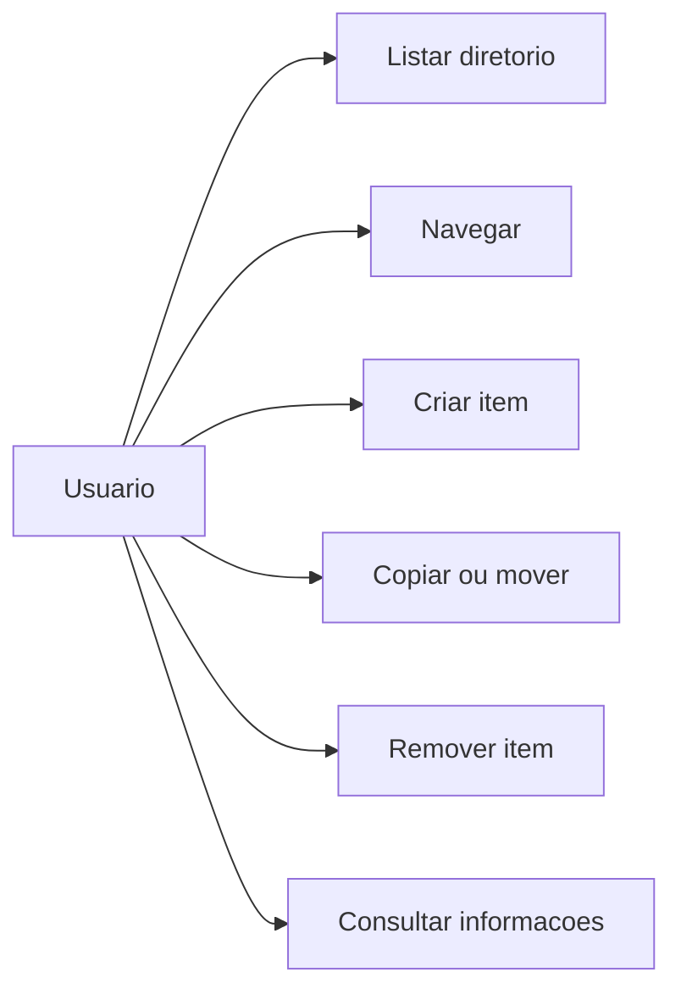
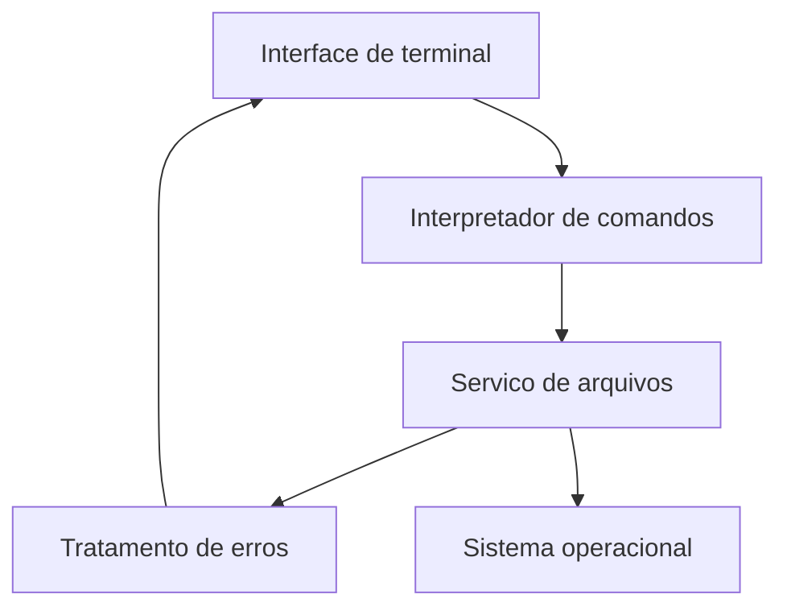
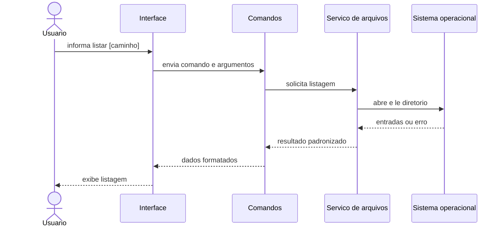

# UML

Os diagramas usam Mermaid e podem ser visualizados em editores que suportam
Markdown com Mermaid.

## Casos de uso

## Componentes

## Sequencia: listar diretorio

## Observacao

Os diagramas representam a arquitetura planejada. Devem ser atualizados quando
os modulos e contratos publicos forem implementados.
