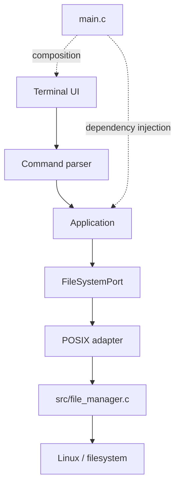
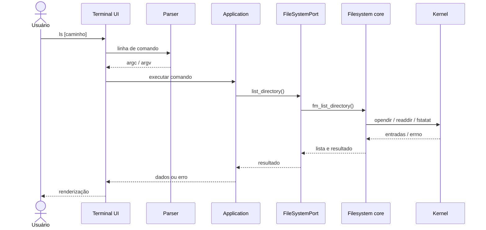
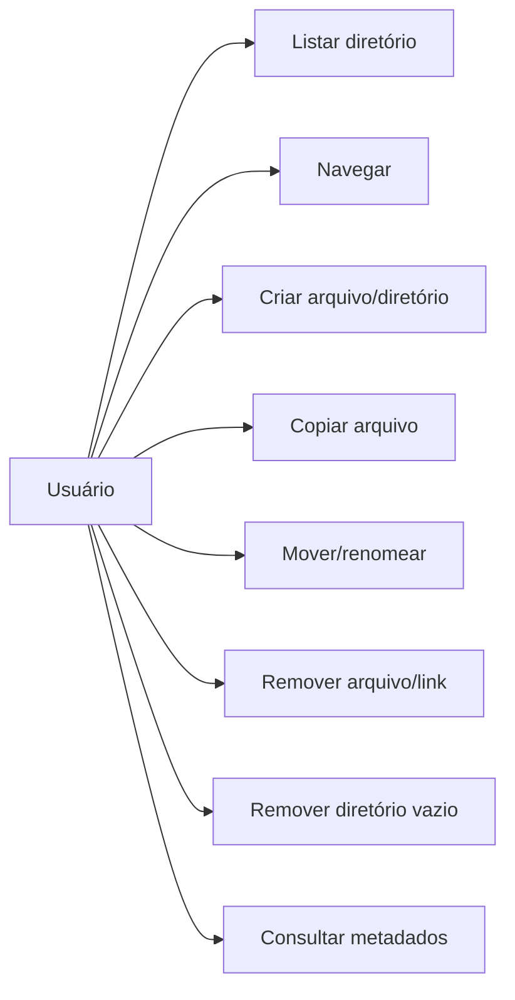

# Diagramas de análise e projeto

Os diagramas são mantidos em Mermaid para que alterações arquiteturais possam ser revisadas junto ao código.

## Diagrama de componentes

O adapter é uma tabela de encaminhamento. A implementação das operações e syscalls ainda reside em `src/file_manager.c`.

## Diagrama de sequência: listagem

## Diagrama de caso de uso

Para responsabilidades, contratos e limites de cada componente, consulte [arquitetura](arquitetura.md). Para comportamento de caminhos e syscalls, consulte [segurança](seguranca.md).
